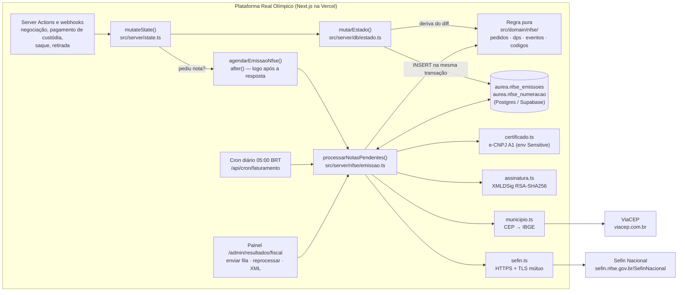
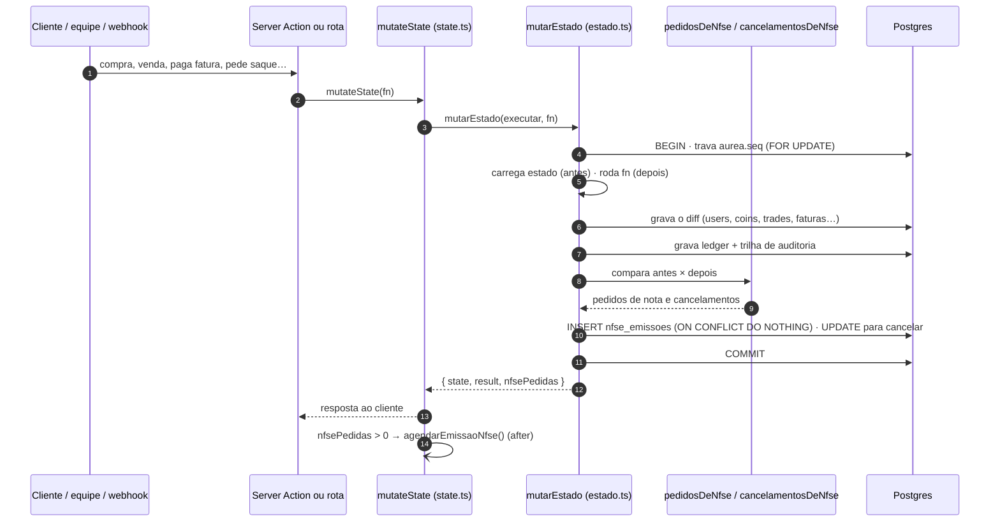
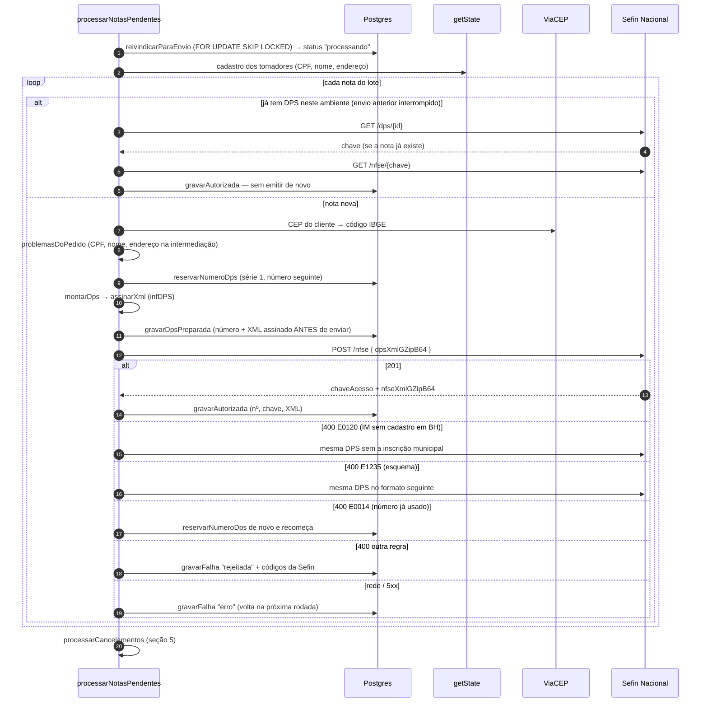
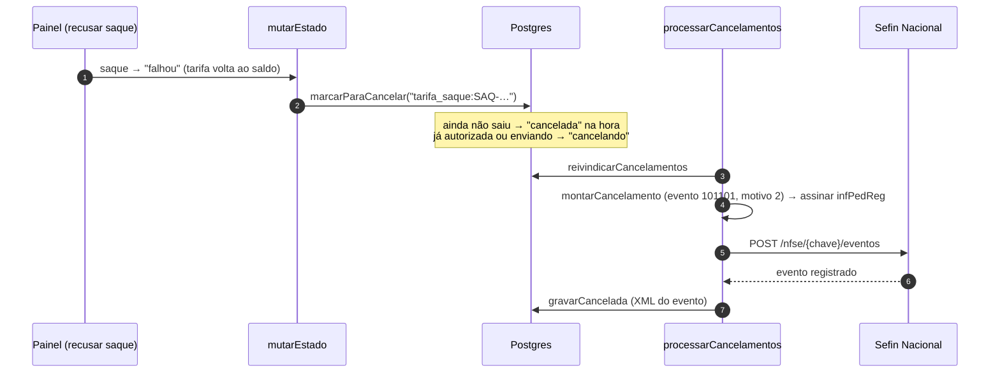
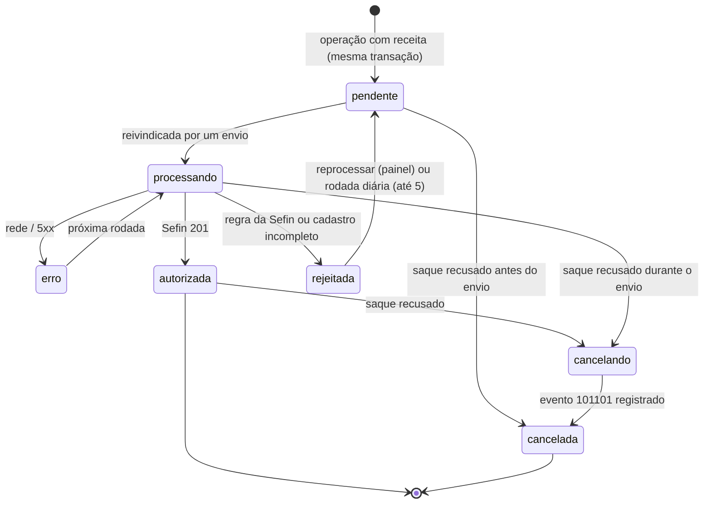

# API NFS-e Nacional — como a plataforma emite nota fiscal no governo

**Real Olímpico / AUREA CUSTODIA LTDA (CNPJ 68.071.452/0001-06) · documento de referência da integração ·
23/10/2026.** Estado: **emissão real ligada em produção** (`NFSE_AMBIENTE=producao`) desde 23/10/2026,
commits `90a4fa7` e `8601395`. As regras de negócio por trás de cada decisão estão em
`REGRAS_FISCAIS_E_CONTABEIS.md`; a pesquisa técnica de origem, em `pesquisa/PESQUISA_NFSE_NACIONAL.md`.

---

## 0. Em uma página, para o Rogério

- Toda vez que a plataforma **ganha dinheiro com um serviço** — comissão de uma negociação, custódia paga,
  tarifa de saque, taxa de retirada da moeda —, ela **pede uma nota fiscal ao governo sozinha**, segundos
  depois, sem ninguém da equipe precisar entrar no site da prefeitura.
- O "governo", aqui, é o **Sistema Nacional da NFS-e** (gov.br/nfse), que Belo Horizonte usa desde fevereiro.
  A API é **gratuita**; o único custo é o certificado digital da empresa, que já temos e vale até 04/08/2027.
- O pedido de nota é **gravado junto com a operação**: se a negociação aconteceu, o pedido existe. Se o
  governo estiver fora do ar, a nota sai depois, sozinha, com a data certa.
- **Sem pagamento, sem nota e sem imposto.** Fatura de custódia em aberto não gera nada.
- Se um saque for recusado, a nota da tarifa é **cancelada** sozinha.
- Tudo aparece no painel em **Notas fiscais** (`/admin/resultados/fiscal`): número, chave, XML, motivo de cada
  recusa e os botões de reenvio.

---

## 1. Visão geral da arquitetura

**As três camadas, como no resto do repositório:**

| Camada | Pasta | O que faz | Pode chamar rede? |
|---|---|---|---|
| Regra pura | `src/domain/nfse/` | Decide que nota cada operação gera, monta o XML do pedido (DPS) e do cancelamento, guarda a tabela de códigos | Não |
| Persistência | `src/server/db/repositories/nfse.ts` + migrations 044/045 | A fila de notas e a numeração das DPS | Só o banco |
| Integração | `src/server/nfse/` | Certificado, assinatura, cliente da Sefin, CEP, orquestração do envio | Sim (Sefin e ViaCEP) |
| Painel | `src/app/(admin)/admin/resultados/fiscal/`, `src/components/admin/resultados/NotasFiscais.tsx`, `src/server/actions/admin/fiscal.ts`, `src/server/admin/fiscal.ts` | Tela, filtros e ações da equipe | Via Server Action |

Nada de `src/server/nfse/` pode ser importado por Client Component: ele carrega o certificado da empresa.

---

## 2. Onde a nota nasce — o gatilho dentro do sistema

A nota **não** é pedida por cada Server Action. Ela nasce do **diff do estado**, no mesmo lugar e na mesma
transação em que o livro-razão é gravado. É isso que garante que nenhum dos caminhos por onde o dinheiro se
move fique sem nota.

### Que operação gera que nota (`src/domain/nfse/pedidos.ts`)

| Fato no sistema (diff) | Nota | Tomador | Valor | Competência (`dCompet`) | Chave única |
|---|---|---|---|---|---|
| Negociação nova em `state.trades` | **2 notas**: comissão de compra e comissão de venda | comprador / vendedor | `feeComprador` / `feeVendedor` | dia do casamento | `intermediacao_compra:TRADE-n` / `intermediacao_venda:TRADE-n` |
| Fatura de custódia que **passou a `paga`** (inclui a do 1º mês dentro da compra e a de cada ciclo) | Custódia | dono da fatura | `valorCents` | dia do **pagamento** | `custodia:<id da fatura>` |
| Saque novo com tarifa | Tarifa de saque | quem sacou | `taxa` (R$ 5,00) | dia do **pedido** do saque | `tarifa_saque:<id do saque>` |
| Retirada física que passou a `paga` | Taxa de retirada | quem retirou | `valorTaxaCents` | dia do pagamento | `taxa_retirada:<id da retirada>` |
| Saque que passou a `falhou` (recusado / Pix devolvido) | **Cancela** a nota da tarifa | — | — | — | `tarifa_saque:<id do saque>` |
| Fatura em aberto, depósito, frete, saque (valor líquido), semeadura de teste | **nenhuma** | — | — | — | — |

`TRADE-n` é a mesma referência que o ledger usa (`ref_interna`), o que liga cada nota de comissão à linha do
livro-razão dos dois clientes.

---

## 3. O envio: do pedido à nota autorizada

### Quem dispara o envio

| Disparo | Onde | Quando | O que pega |
|---|---|---|---|
| `agendarEmissaoNfse()` | `src/server/nfse/agendar.ts`, chamado por `src/server/state.ts` | logo após a operação que pediu nota (`after()` do Next) | pendentes e erros |
| Cron diário | `/api/cron/faturamento` (`vercel.json`, 08:00 UTC = 05:00 BRT) | todo dia | pendentes, erros e **rejeitadas** até 5 tentativas (o cliente pode ter completado o cadastro) |
| Botão "Enviar fila agora" | `enviarFilaDeNotas()` em `src/server/actions/admin/fiscal.ts` | quando a equipe quiser | pendentes e erros |
| Botão "Reprocessar" | `reprocessarNotas()` | quando a equipe quiser | devolve rejeitadas/erros à fila, zera tentativas e envia |

Dois envios ao mesmo tempo nunca pegam a mesma nota: a reivindicação usa `FOR UPDATE SKIP LOCKED`.

---

## 4. A conexão com o governo

### 4.1 Endpoints usados

Base: produção `https://sefin.nfse.gov.br/SefinNacional` · testes (produção restrita)
`https://sefin.producaorestrita.nfse.gov.br/SefinNacional`.

| Método e caminho | Para quê | Função | Corpo / resposta |
|---|---|---|---|
| `POST /nfse` | emitir | `enviarDps` | envia `{ "dpsXmlGZipB64": "<DPS assinada → GZip → Base64>" }`; 201 devolve `chaveAcesso`, `idDps`, `nfseXmlGZipB64`, `alertas`; 400 devolve `erros[]` (`codigo`, `descricao`, `complemento`) |
| `GET /dps/{idDps}` | saber se uma DPS já virou nota (após timeout) | `chaveDaDpsJaEmitida` | 200 com `chaveAcesso`; 404 se não |
| `GET /nfse/{chave}` | baixar o XML de uma nota | `consultarNfse` | `nfseXmlGZipB64` |
| `POST /nfse/{chave}/eventos` | cancelar | `enviarEvento` | envia `{ "pedidoRegistroEventoXmlGZipB64": "…" }`; 200/201 devolve `eventoXmlGZipB64` |

Fora dela: `GET https://viacep.com.br/ws/{cep}/json/` (`codigoIbgeDoCep`), para o código IBGE do município
do cliente, que a nota exige e que o cadastro não guarda.

### 4.2 Autenticação e segurança

| Item | Como é feito | Por quê |
|---|---|---|
| Identidade | **TLS mútuo** com o e-CNPJ A1 da empresa (AC Safeweb RFB v5, válido até **04/08/2027**) | A API não aceita usuário e senha |
| Assinatura | XMLDSig *enveloped* sobre `infDPS` (e `infPedReg` no cancelamento): RSA-SHA256, canonicalização exclusiva, digest SHA-256, só o certificado no `KeyInfo` | Aceito pela Sefin em 23/10/2026 |
| Onde o certificado mora | `NFSE_CERT_PFX_BASE64` + `NFSE_CERT_SENHA` — `.env.local` e Vercel (*Sensitive*); original em `docs/privado/certificados/` | **Nunca no Git**: o repositório é público e o arquivo com a senha assina como a empresa |
| Como o certificado é aberto | `node-forge` extrai chave e cadeia em PEM | O OpenSSL 3 do Node recusa a cifra antiga do .pfx ("Unsupported PKCS12 PFX data") |
| Transporte | `node:https`, HTTP/1.1, 30 s de tempo limite | A Sefin recusa HTTP/2 nos caminhos autenticados |
| Corpo | XML em UTF-8 **com** `<?xml version="1.0" encoding="UTF-8"?>`, GZip, Base64, dentro de JSON | Sem a declaração a Sefin recusa (E1229) |
| Banco | `nfse_emissoes` e `nfse_numeracao` com RLS ligada | Os XMLs têm CPF e endereço do cliente |

### 4.3 Ambientes

| `NFSE_AMBIENTE` | Para onde vai | `tpAmb` | Onde está configurado |
|---|---|---|---|
| `producao` | `sefin.nfse.gov.br` — nota fiscal de verdade | 1 | Vercel **Production** (ligado em 23/10/2026) |
| qualquer outro / vazio | produção restrita — nota de teste "sem validade jurídica" | 2 | Vercel Preview e `.env.local` |

Trava de segurança: no site publicado (`VERCEL_ENV=production`) **sem** `NFSE_AMBIENTE=producao`, nada é
enviado — a fila espera e as notas saem com a data de cada fato quando a produção é ligada. Uma nota autorizada
só na restrita é reemitida em produção quando a produção liga.

---

## 5. Cancelamento

Prazo em BH: cancelamento direto até **730 dias** da emissão (Portaria SMFA 75/2025); depois, só por análise
fiscal. Se uma autorização chegar depois do pedido de cancelamento (envio em andamento), a nota continua
`cancelando` e o evento sai em seguida.

---

## 6. Os dados

### 6.1 O que entra no pedido de nota (DPS) e de onde vem

| Campo da DPS | Valor | Fonte |
|---|---|---|
| `Id` | `DPS` + 3106200 + 2 + CNPJ + série (5) + número (15) — 45 posições | `idDaDps` |
| `tpAmb` | 1 produção / 2 restrita | `NFSE_AMBIENTE` |
| `dhEmi` | agora − 30 s, horário de Brasília (`-03:00`) | relógio do servidor (a Sefin recusa data futura) |
| `verAplic` | `RealOlimpico-1.0` | `VERSAO_APLICATIVO` |
| `serie` / `nDPS` | série 1 (`NFSE_SERIE`; faixa da API 1–49999) / sequencial por ambiente | `nfse_numeracao` |
| `dCompet` | dia de Brasília do fato (casamento ou pagamento) | `PedidoNfse.competencia` |
| `prest` | CNPJ 68071452000106, **IM 17957450014** (sai se a Sefin responder E0120), não optante do Simples, sem regime especial | `EMISSOR` em `codigos.ts` |
| `toma` | CPF, nome, endereço (logradouro, número, complemento, bairro, CEP, município IBGE) | `users[email].cadastro` + ViaCEP |
| `serv/cServ` | código nacional, municipal, NBS, descrição (maiúsculas, sem acento) | `CODIGOS_POR_SERVICO` |
| `valores/vServ` | valor cobrado, bruto — nunca o líquido do Mercado Pago | `PedidoNfse.valorCents` |
| `tribMun` | ISS tributável, não retido; **alíquota não vai** (a Sefin aplica a de BH — E0617) | fixo |
| `tribFed/piscofins` | CST 01, PIS 0,65%, COFINS 3,00%, valores arredondados ao centavo | `TRIBUTOS_FEDERAIS` |
| `totTrib/pTotTrib` | federal 11,33% · estadual 0% · municipal = ISS do serviço (Lei 12.741) | `TRIBUTOS_FEDERAIS` + `issBp` |
| `IBSCBS` | `indFinal` 0, `cIndOp`, `tpOper` 5 só na intermediação, CST 000 / cClassTrib 000001 — valores calculados pela Sefin | `CODIGOS_POR_SERVICO` |

### 6.2 A tabela de códigos (espelho das notas do contador)

| Serviço | cTribNac / cTribMun | NBS | ISS BH | cIndOp | tpOper | Descrição na nota |
|---|---|---|---|---|---|---|
| Custódia | 11.04.01 / 001 | 1.0602.90.00 | 5% | 050101 | — | `CUSTODIA MENSAL - 25/10/2026 A 25/11/2026 - 1 MOEDA - REF FAT-…` |
| Comissão de compra | 10.05.01 / 003 | 1.0201.00.00 | 3% | 100301 | 5 | `INTERMEDIACAO NA COMPRA DE MOEDA - 1 MOEDA - REF TRADE-n` |
| Comissão de venda | 10.05.01 / 003 | 1.0201.00.00 | 3% | 100301 | 5 | `INTERMEDIACAO NA VENDA DE MOEDA - 1 MOEDA - REF TRADE-n` |
| Tarifa de saque | 11.04.01 / 001 | 1.0602.90.00 | 5% | 050101 | — | `TARIFA DE SAQUE - REF SAQ-…` |
| Taxa de retirada | 11.04.01 / 001 | 1.0602.90.00 | 5% | 050101 | — | `TAXA DE RETIRADA DE MOEDA DA CUSTODIA - MOEDA RO-… - 1 MOEDA - REF RET-…` |

Mudou o entendimento do contador? Muda `src/domain/nfse/codigos.ts`, e só ele.

### 6.3 Leiaute e transição para a NT 009

O pedido é montado pela ordem do XSD oficial. Quatro posições mudam com a NT 009 (obrigatória em 01/12/2026) e
são controladas por `FormatoDps`:

| Diferença | v1.01 (produção até 30/11) | NT 009 | Produção restrita em 23/10/2026 |
|---|---|---|---|
| `finNFSe` | dentro de `IBSCBS` | raiz, depois de `tpEmit` | raiz |
| `indDest` | dentro de `IBSCBS` | raiz, depois de `toma` | dentro de `IBSCBS` |
| CST / cClassTrib | dentro de `gIBSCBS` | direto em `trib` | direto em `trib` |
| `xDescServ` | antes de `cNBS` | depois de `cNBS` | depois de `cNBS` |

`formatosATentar` escolhe a ordem pela data e pelo ambiente; uma recusa de esquema (E1235) não gera nota nem
gasta número, e o envio tenta o formato seguinte.

### 6.4 A fila no banco (`aurea.nfse_emissoes`, migrations 044 e 045)

| Coluna | O que guarda |
|---|---|
| `chave` (única) | `servico:refFato` — uma nota por fato, por tomador, por serviço |
| `servico` | `custodia`, `intermediacao_compra`, `intermediacao_venda`, `tarifa_saque`, `taxa_retirada` |
| `ref_fato`, `tomador_email`, `valor`, `ocorrido_em`, `competencia`, `descricao`, `quantidade_moedas` | o pedido |
| `status` | ver diagrama abaixo |
| `ambiente`, `serie`, `n_dps`, `id_dps`, `xml_dps` | o pedido enviado (gravado **antes** do envio) |
| `chave_acesso`, `numero_nfse`, `xml_nfse`, `autorizada_em` | a nota autorizada — o XML é o documento fiscal oficial |
| `erros` (jsonb), `tentativas` | recusa da Sefin ou impedimento local (`CADASTRO`, `REDE`, `INTERNO`) |
| `motivo_cancelamento`, `cancelada_em`, `xml_cancelamento` | o cancelamento |

`aurea.nfse_numeracao (ambiente, serie, ultimo)` guarda o último número de DPS; a restrita começou em 6
porque os testes de integração usaram os primeiros números.

---

## 7. Códigos de retorno da Sefin que o sistema trata sozinho

| Código | Significado | Reação |
|---|---|---|
| — (201) | nota gerada | grava nº, chave e XML |
| E0014 | número de DPS já usado com nota | reserva o próximo número e reenvia (até 3 vezes) |
| E0120 | IM não deve ser informada (BH sem a IM no cadastro nacional complementar) | reenvia a mesma DPS sem `IM` |
| E1235 | falha no esquema XML | tenta o próximo formato (transição da NT 009) |
| E1229 | XML sem codificação UTF-8 declarada | evitado: a declaração vai sempre |
| E0187 / E0234 | tomador sem endereço numa nota que exige (intermediação) | barrado **antes** do envio: `rejeitada` com código `CADASTRO` |
| E0207 | CPF inexistente na Receita | `rejeitada`; corrigir o cadastro e reprocessar |
| rede, timeout, 5xx | — | `erro`; antes de reenviar, pergunta `GET /dps/{id}` para não emitir duas vezes |

---

## 8. Operação do dia a dia

| Situação | O que fazer |
|---|---|
| Ver as notas | painel → **Notas fiscais**; filtros por situação e busca por e-mail, `TRADE-n`, `FAT-…`, `SAQ-…` ou nº da nota |
| Nota "Recusada" por cadastro | completar CPF/endereço do cliente → **Reprocessar** (ou esperar a rodada diária) |
| Governo fora do ar | nada: as notas ficam em "Erro de envio" e saem na próxima rodada; ou **Enviar fila agora** |
| Baixar o documento fiscal | botão **XML** (o PDF é só representação; ainda não é gerado pela plataforma) |
| Trocar código, alíquota aproximada ou `tpOper` | `src/domain/nfse/codigos.ts` |
| Desligar a emissão real | apagar `NFSE_AMBIENTE` na Vercel (Production) e republicar — a fila passa a esperar |
| Certificado perto de vencer (julho/2027) | gerar o novo A1, trocar `NFSE_CERT_PFX_BASE64` e `NFSE_CERT_SENHA` no `.env.local` e na Vercel |
| Conferir uma nota no governo | portal nacional da NFS-e, pela chave de acesso de 50 dígitos |

Permissões: ver a tela = `resultados.ver`; enviar à Sefin, reprocessar = `resultados.nfse`. Toda ação grava
`admin.fiscal.enviar_fila` ou `admin.fiscal.reprocessar` na trilha de auditoria.

---

## 9. Como foi testado

| Prova | Onde |
|---|---|
| As 3 notas do contador reproduzidas campo a campo; regras de quando a nota nasce; tarifa, retirada, cancelamento, IM, NT 009 | `src/domain/nfse/nfse.test.ts` (24 testes) |
| Fila no Postgres embutido: pedido na transação, sem duplicar, numeração, reivindicação, cancelamento | `src/server/db/nfse-fila.test.ts` (8 testes) |
| Produção restrita, com o certificado real: notas de teste nº 1 a 7 autorizadas; valores do governo iguais aos do contador ao centavo (ISS 0,10/0,06, base IBS/CBS 1,83/1,87, CBS 0,02); recuperação após envio interrompido sem segunda nota; troca de número por E0014; reenvio sem IM por E0120; cancelamento das notas nº 1 e nº 7 | scripts de integração de 23/10/2026 (fora do repositório) |

**O que ainda só se prova em produção:** o leiaute que a Sefin de produção aceita até 30/11/2026 (o envio
tenta os três formatos) e se BH aceita a inscrição municipal (senão, E0120 → sem ela).

---

## 10. Limites conhecidos

- **PDF (DANFSe)** não é gerado pela plataforma ainda (a API oficial de PDF foi suspensa em 03/08/2026).
- **Cancelamento manual** pelo painel não existe; o automático (saque recusado) existe.
- **Consolidado sob demanda** (demonstrativo por cliente e período) está desenhado em
  `NFSE_INTEGRACAO_NO_SITE.md` §5b, não implementado.
- **Operações anteriores a 23/10/2026** não têm nota automática (decisão do Gabriel pendente).
- **Retirada paga e depois cancelada** não cancela a nota da taxa: o sistema não devolve essa taxa hoje.
- **Conferência contra o ADN** (baixar todas as notas do CNPJ, inclusive as do contador) não está ligada.
